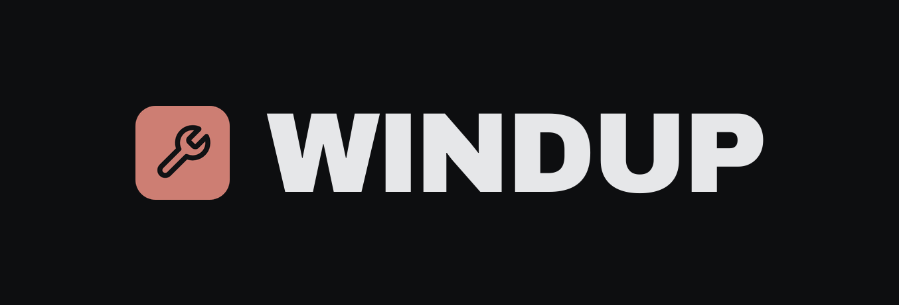

<p align="center">
  <picture>
    <source media="(prefers-color-scheme: light)" srcset="docs/images/banner-paper.png">
    
  </picture>
</p>

<p align="center">
  Small desktop tools that live behind a <b>hotkey</b>, for Windows and Linux,
  in the spirit of PowerToys.
</p>

<p align="center">
  Clipboard history at your cursor · plain-text paste · screenshots with an
  editor · screen recording · step-by-step guides · one settings window · runs
  in the background
</p>

> **Early days.** Six tools work, on Windows and on Linux: clipboard history,
> plain-text paste, two ways to take a screenshot, screen recording and
> step-by-step guides. [What is not there yet](#what-is-not-there-yet) is honest about the
> rest.

## Install

**Windup 0.4.2.** Take the installer for your PC, or browse the
[release itself](https://github.com/Spillebulle/Windup/releases/latest) for the
notes.

| | x64 | ARM64 |
|---|---|---|
| Windows | [Installer](https://github.com/Spillebulle/Windup/releases/download/v0.4.2/windup-setup-0.4.2-x64.exe) | [Installer](https://github.com/Spillebulle/Windup/releases/download/v0.4.2/windup-setup-0.4.2-arm64.exe) |
| Windows, `.msi` to deploy | [`.msi`](https://github.com/Spillebulle/Windup/releases/download/v0.4.2/windup-0.4.2-x64.msi) | [`.msi`](https://github.com/Spillebulle/Windup/releases/download/v0.4.2/windup-0.4.2-arm64.msi) |
| Windows, no installer | [`.zip`](https://github.com/Spillebulle/Windup/releases/download/v0.4.2/windup-0.4.2-x86_64-pc-windows-msvc.zip) | [`.zip`](https://github.com/Spillebulle/Windup/releases/download/v0.4.2/windup-0.4.2-aarch64-pc-windows-msvc.zip) |
| Debian, Ubuntu, Mint, Pop!\_OS | [`.deb`](https://github.com/Spillebulle/Windup/releases/download/v0.4.2/windup_0.4.2_amd64.deb) | |
| Fedora, openSUSE | [`.rpm`](https://github.com/Spillebulle/Windup/releases/download/v0.4.2/windup-0.4.2-1.x86_64.rpm) | |
| Arch, CachyOS, EndeavourOS, Manjaro | [`.pkg.tar.zst`](https://github.com/Spillebulle/Windup/releases/download/v0.4.2/windup-bin-0.4.2-1-x86_64.pkg.tar.zst) | |
| Any other Linux | [AppImage](https://github.com/Spillebulle/Windup/releases/download/v0.4.2/Windup-0.4.2-x86_64.AppImage) | |
| Linux, no package | [`.tar.gz`](https://github.com/Spillebulle/Windup/releases/download/v0.4.2/windup-0.4.2-x86_64-unknown-linux-gnu.tar.gz) | |

The installer asks Windows for permission once, installs for everyone on the
PC, adds Windup to the Start menu and starts it. Uninstall it from Settings,
Apps. The files are not signed yet, so SmartScreen may warn the first time;
choose More info, then Run anyway.

You need Windows 10 or 11 and a GPU with Direct3D 12 or Vulkan, which is
essentially any machine from the last ten years.

On Linux, install the package for your distribution (`sudo apt install
./windup_0.4.2_amd64.deb`, `sudo dnf install ./windup-0.4.2-1.x86_64.rpm`,
`sudo pacman -U windup-bin-0.4.2-1-x86_64.pkg.tar.zst`) and start Windup from
the app menu. Each of the three packages also adds the
[Spillebulle package archive](https://spillebulle.github.io/packages/), so
Windup updates with the rest of the system (`sudo apt upgrade`,
`sudo dnf upgrade`, `sudo pacman -Syu`). Wayland and X11 both work.
**Most Wayland desktops do not let an app take Super+V by itself**: bind it
once to `windup --popup` in your desktop's keyboard settings.
[`docs/linux.md`](docs/linux.md) has the steps for COSMIC, GNOME, KDE, Sway,
Hyprland and the rest, and what works where.

## Clipboard history

Press Win+V (Super+V on Linux) and a popup opens at your cursor with everything you have copied,
images included, with previews. Pick an entry and Windup pastes it into the
window you were in. It replaces the Windows clipboard panel rather than
sitting beside it. On Linux, copies a password manager marks as secret
(KeePassXC, Bitwarden, 1Password) are never recorded.

## Paste plain text

Press Win+Shift+V (Super+Shift+V) to paste what is on the clipboard with its fonts, colours
and links stripped. Useful when copying out of a web page or a document into
anything that would otherwise keep the formatting.

## Screenshots

Press Print Screen and the screen freezes under a capture bar: drag an area,
click a window or take the whole screen. Then draw on it with a pen, boxes and
ellipses, blur or mosaic what should not be seen, and copy or save it.
Ctrl+Shift+S skips the bar and opens a screenshot in the editor at once.

## Screen recording

Press Win+Shift+R (Super+Shift+R) and the capture bar opens ready to record:
pick an area, a window or the whole screen, and the frame rate, the bitrate
and whether to record the computer's sound or the microphone, both off until
you turn them on. A small bar with a timer, pause and stop stays out of the
picture while you record. Press the same keys again to stop, Win+Shift+P to
pause, Esc to throw the recording away. The file lands in Videos, Windup, as
MP4 unless you choose WebM, MOV, MKV or a GIF, encoded on the graphics card
where it can be. The Video settings pane has the codec, the encoder and the
sound devices.

## Steps

Press Win+Shift+G (Super+Shift+G) and Windup records a step-by-step guide:
every click takes a picture of the screen under the pointer, with a marker
where you clicked, and Win+Shift+X takes a step by hand. A small bar counts
the steps and stays out of the pictures. Press the same keys again to stop,
and a review opens: give each step a caption, remove the ones you do not
want, or open one in the editor to blur or point something out. Export it as
one web page with the pictures inside, a PDF, Markdown with an images folder,
or just the numbered pictures, to Documents, Windup. Esc throws the steps
away. On Wayland, clicks need a one-time setup, which the packages do for
you; [`docs/linux.md`](docs/linux.md) says how.

## What is not there yet

- **No tray icon, and no start at sign-in on Windows.** Both settings are
  saved; on Linux "Launch at login" works, on Windows neither does yet. Start
  it from the Start menu.
- **Unsigned.** The installer and program are not code-signed.
- **On Linux, a shortcut to bind.** Except on X11 and on desktops with the
  GlobalShortcuts portal (KDE Plasma, GNOME 48 and newer, Hyprland), Super+V
  is bound by hand once; see [`docs/linux.md`](docs/linux.md).
- **On GNOME the popup opens mid-screen**, not at the cursor: GNOME keeps the
  overlay layer other desktops offer to itself. Pasting asks for permission
  once.
- **No ARM64 Linux packages yet**, and no macOS.

## Controls

| Shortcut | Does |
|---|---|
| Win+V, Super+V | Open clipboard history at the cursor |
| Win+Shift+V, Super+Shift+V | Paste the clipboard as plain text |
| Print Screen | Open the capture bar |
| Ctrl+Shift+S | Take a screenshot at once |
| Win+Shift+R, Super+Shift+R | Start a recording, or stop it |
| Win+Shift+P, Super+Shift+P | Pause or resume a recording, or Steps |
| Win+Shift+G, Super+Shift+G | Start recording steps, or stop and review them |
| Win+Shift+X, Super+Shift+X | Take a step by hand |
| Type | Search the history |
| Up, Down | Move through the history |
| Enter | Paste the selected entry |
| Delete | Remove the selected entry |
| Esc | Close the popup, or cancel a recording or Steps |

Every tool can be switched off in the settings window, and every shortcut
changed there. Where a Linux desktop keeps the keys to itself, they live in
its keyboard settings.

## Building from source

```sh
git clone https://github.com/Spillebulle/Windup.git
cd Windup
cargo build --release      # target/release/windup(.exe)
```

Rust 1.90 or newer. On Linux, `sh packaging/linux/dependencies.sh` installs
the system libraries on Debian and Ubuntu; elsewhere you need the development
packages for libxkbcommon, Wayland, X11 and libxdo.

## Licence

GPL-3.0-or-later, see [`LICENSE`](LICENSE). The Archivo typeface is under the
SIL Open Font Licence ([`assets/OFL.txt`](assets/OFL.txt)); icons are from
[Lucide](https://lucide.dev) (ISC). Recordings are encoded by a bundled
[FFmpeg](https://ffmpeg.org), a GPL build that ships with its licence and a
note saying where its source is.
